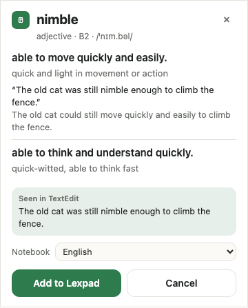
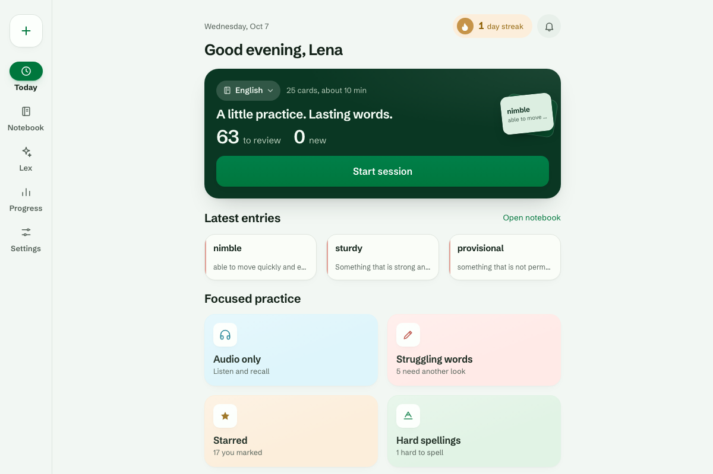
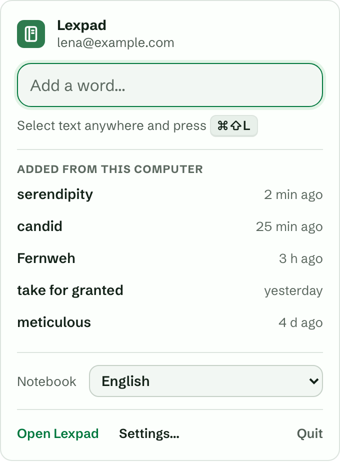
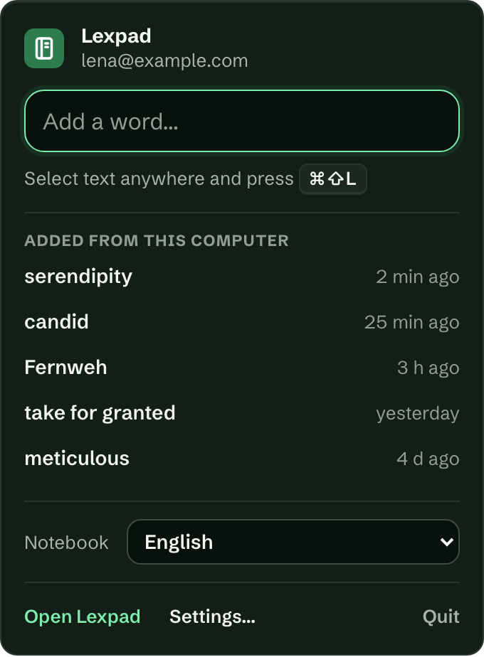
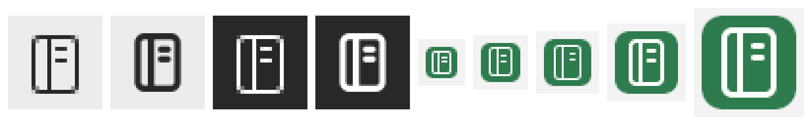

# Lexpad for macOS and Windows

[Lexpad](https://lexpad.app) is a personal vocabulary notebook with spaced repetition. You write
down the words and phrases you meet, in any pair of 81 languages; AI can complete each one into a
full card (meanings, examples, pronunciation, level), and short daily sessions on a five-box
Leitner schedule keep them learned. Lexpad never chooses words for you: it has no courses or
ready-made word lists. It runs on the web ([app.lexpad.app](https://app.lexpad.app)), on Android,
in Chrome and Firefox, in ChatGPT and Claude, and on your computer with this app.

**Download:** [Lexpad for Mac](https://lexpad.app/download/mac) (macOS 11 or later, Apple
silicon and Intel) · [Lexpad for Windows](https://lexpad.app/download/windows) (Windows 10 or 11,
64-bit) · [every platform](https://lexpad.app/download). The download pages give the version, the
SHA-256 checksums and honest install steps. More: [what the desktop app does](https://lexpad.app/features/desktop),
[all features](https://lexpad.app/features).
Lexpad for Mac and Windows is out of beta since 21 October 2026: the Mac app is signed and
notarized by Apple, and the Windows app is in the [Microsoft Store](https://apps.microsoft.com/detail/9NSFK2ZK6PFS).

| The card, over any app                                          | The whole app in its own window                                  |
| --------------------------------------------------------------- | ---------------------------------------------------------------- |
|  |  |

Add the words you meet in **any** app to your [Lexpad](https://lexpad.app) notebook.

Select a word in a document, an e-mail, a PDF or a chat, press **⌘⇧L** on a Mac or
**Ctrl+Shift+L** on Windows, and a small card shows its part of speech, level, pronunciation
and up to three meanings with examples. Press **Enter** to add it, **Esc** to close. The sentence
you met it in is kept as its first example, and a private note says where: "Seen in Microsoft
Word". Nothing selected? A small box lets you type the word. Selected a whole sentence? Pick the
word out of it, and the sentence comes along.

Lexpad lives in the menu bar (macOS) or the system tray (Windows), starts when you log in (you
can turn that off), and runs once. From 0.2 it is also the whole Lexpad app in a window of its
own: Today, practice (offline too), the notebook, Lex, Progress and Settings. Click its icon for a small panel: type a word to add it, see
your shortcut, the last words you added from this computer (click one to open it in Lexpad),
pick the notebook new words go to, "Lexpad on your phone…" (it says "Lexpad everywhere…" once
you have used a Lexpad phone app; it opens Settings → Lexpad everywhere), and Open Lexpad,
Settings or Quit. Esc or a click elsewhere closes it. Right-click the icon for a short menu:
Open Lexpad, Open a video…, the same Lexpad everywhere item when you are signed in, Settings…
and Quit Lexpad.

| Light                                                 | Dark                                                |
| ----------------------------------------------------- | --------------------------------------------------- |
|  |  |

The icons: 

Lexpad never asks for your password: you allow it from Lexpad in your browser, and it appears
under Settings → Signed-in devices as "Desktop app", where it can be signed out on its own.

On macOS there is also **Services → Add to Lexpad** when you right-click a selection.

## What leaves your computer

- When you look a word up: the word, and the sentence it was in as a hint for the meaning.
- When you add it: the word, its meaning, that sentence as an example, and the private note
  "Seen in <app name>".
- About once a day, while Lexpad's window is open: a request for `lexpad.app/version.json`
  (which versions are out), with nothing but the app's version, the system and, on Windows,
  whether it came from the Microsoft Store in its User-Agent. No account, no session.
- Never a window title (they carry document names, e-mail subjects and the names of people you
  chat with), never the rest of the text, never anything you did not select. The selection is
  read only at the moment you press the shortcut.

On macOS, reading another app's selection needs the **Accessibility** permission (System
Settings → Privacy & Security → Accessibility). Lexpad explains this and opens the right pane;
without it you can still type a word. The card and Settings notice within a few seconds when
you allow it (no restart needed). From 0.3.3 every Mac release is signed with the same
certificate, so macOS keeps the permission across updates; if you update from 0.3.2 or older,
remove Lexpad from the Accessibility list with − and add it again once, then reopen Lexpad.
Where an app does not share its selection, Lexpad copies
it (⌘C / Ctrl+C) and then puts your clipboard back exactly as it was.

## Licence and trust

The code is public so you can see exactly what this app does with the **Accessibility**
permission and with the text you select: read it in `src-tauri/src/capture/` (macOS and
Windows), and what it sends in `src-tauri/src/api.rs`. In short, it reads the selection only when
you press the shortcut, and of what you select it sends only what is listed under "What leaves
your computer" above, to the Lexpad API (`api.lexpad.app`) over HTTPS. The window is the same
Lexpad app as on the web, talking to the same API through the app's core (`src-tauri/src/proxy.rs`
says what it may send).

It is **source-available, not open source**: all rights reserved. You may read it and build it
to check what it does, and for your own personal, non-commercial use; you may not redistribute,
sell or publish changed versions. The Lexpad name, logo and icons are not licensed. See
[LICENSE](LICENSE). To report a security problem privately, see [SECURITY.md](SECURITY.md).

## Changelog

The full notes for every release are in its [GitHub release](https://github.com/rezapirighadim/lexpad_desktop/releases)
and on the site changelog, [lexpad.app/changelog](https://lexpad.app/changelog). In short, since 0.3.6:

- **0.3.16** (24 October 2026): the Pro trial's moments on Today follow its length.
- **0.3.15** (24 October 2026): links in the window open the browser again; a notice on Today when a new version is ready; a daily reminder offered after the first practice; the add sheet's "not a word" answer with Save without AI.
- **0.3.14** (22 October 2026): the web app of 22 October: the new first run, a Today that grows with the notebook, and an add sheet with one next-step button.
- **0.3.13** (21 October 2026): notification buttons and short forms in the bell; a notification opens its own page.
- **0.3.12** (21 October 2026): importing takes the files people have: Excel workbooks, older CSV encodings, Google Translate phrases, older Kindle clippings, big Anki decks.
- **0.3.11** (20 October 2026): Lex proposes changes as cards; a visible wait for an AI card.
- **0.3.10** (18 October 2026): Fill with AI for every word without a meaning; Anki decks; check before an import is added, with Undo.
- **0.3.8** (14 October 2026): Report is written out under every Lex answer.
- **0.3.7** (13 October 2026): the first Mac release signed and notarized by Apple (Developer ID).

**0.3.6** (13 October 2026)

- Report AI content: a "Report" action (flag) beside everything a model wrote in the window
  (Fill with AI, AI cards, Improve with AI, the sentence verdict, Lex answers), and a "Report"
  link on the shortcut card's AI-written meaning that opens the same form in Lexpad's window.
- The window carries the web app of 13 October, with the new Pro prices shown from the server.
- macOS: signed with the same certificate as 0.3.3 to 0.3.5, so the Accessibility permission
  carries over.

**0.3.5** (13 October 2026)

- The window carries the web app of 13 October: invite friends from Settings → Invite friends
  (you both get Pro days when they start learning), a steadier sign-in when the app starts
  (requests wait for the session being restored), and imports from Anki and Quizlet whose
  fields contain commas now come in as one card each.
- macOS: signed with the same certificate as 0.3.3 and 0.3.4, so the Accessibility permission
  carries over.

**0.3.4** (12 October 2026)

- The window carries the web app of 12 October: in practice, after a wrong answer the card now
  waits with a Next button instead of moving on by itself (from tester feedback). Choose the
  behaviour in Settings → Practice → After an answer.
- macOS: the first update signed with the same certificate as 0.3.3, so the Accessibility
  permission given to 0.3.3 carries over; nothing to do after installing.

**0.3.3** (12 October 2026)

- macOS: Lexpad is now signed with the same certificate in every release, so the Accessibility
  permission survives updates. Updating from 0.3.2 or older: in System Settings, Privacy &
  Security, Accessibility, remove Lexpad with − and add it again, then reopen Lexpad (once).
  The card and Settings now see the permission within a few seconds, without a restart.
- Windows: the desktop shortcut shows the Lexpad icon (the exe's icon now has every size
  Windows draws, in the formats it reads everywhere).
- The window carries the web app of 12 October: Send feedback in Settings, "Did you mean…" when
  you add a misspelled word, Persian notebooks on the same plans as every other language,
  smoother notebook and Today screens, the Games page, celebrations and the introduction.

**0.3.2** (9 October 2026)

- Ready for the Microsoft Store: the Store's copy starts when you log in through Windows' own
  startup list (Settings → Apps → Startup), and its notifications carry the name Lexpad. The
  installer from lexpad.app works as before.

**0.3.1** (9 October 2026)

- The window carries the web app of 9 October: a new introduction (your own word becomes a card
  before you sign up), celebrations for real milestones, Games and drills on their own page,
  "Reminders by e-mail" in Settings, and the daily reminder offered once on the first day's
  summary.

**0.3.0** (9 October 2026)

- The window carries the web app of 8 and 9 October: How words come back for each notebook, the
  Smart schedule (Beta), games and drills, the next 30 days on Progress, streak freeze and the
  first-days screens (they show when the server turns them on for desktop, from 0.3.0); the Pro
  trial on Today and Settings; saving a word even when the AI is out for the day; and Add to my
  notebook from a shared notebook.

**0.2.2** (8 October 2026)

- In the window, going back from a word puts the notebook where you left it: the same words on
  screen, with your search, filters and Show switches as they were (from tester feedback). Today,
  Progress and Settings keep their place on the way back too.

**0.2.1** (8 October 2026)

- The window carries the web app's new sidebar: a clear Add a word button at the top, and it
  remembers whether it is folded or open on this computer.

**0.2.0** (8 October 2026)

- **The whole Lexpad app in a window of its own**: Today, practice, the notebook, Lex, Progress and
  Settings, the same app as on the web and Android, bundled with the app (not loaded from the
  web). Practice works offline and catches up when the connection is back. Open it from the
  panel or the tray menu (Open Lexpad), the Dock, a word in the panel, or at start; Settings can
  send Open Lexpad to the browser instead. The window keeps its size and place.
- It signs in through your browser, like the rest of the app (Google and Apple accounts work),
  and the app's core keeps the only session: the window never holds a token.
- **This computer** in the app's Settings: the shortcut, the notebook it adds to, reading the
  selection, notifications, start-up and the version.
- **Notifications on this computer**: your daily reminder (from your account's reminder time,
  with real counts) and Lexpad's messages such as a gift. A click opens the window.
- After an update, macOS may stop applying the Accessibility permission while the switch still
  looks on; Lexpad now says so and how to fix it.

**0.1.1** (7 October 2026)

- The card always opens wholly on the screen, on the monitor under the pointer: never under the
  menu bar, the Dock or the Windows taskbar (on any edge), below and to the right of the pointer
  or above and to the left where there is no room. It stays on the screen when it grows as the
  meanings arrive, and a card taller than the screen scrolls with Add and Cancel still showing.
- Drag the card by its header to move it; the next shortcut opens it near the pointer again.
- The menu-bar / tray panel keeps to the screen the same way.
- Windows: the card and the panel are placed by what you see, not by the window's invisible
  border, at any display scaling and with monitors left of or above the main one.

**0.1.0** (7 October 2026): first beta. The shortcut and the card, the Services menu on macOS,
the menu-bar / tray panel, Settings, and signing in through the browser.

## Develop

Needs Node 22, pnpm 9 and Rust (stable). Rust was installed with the official installer into
the user's home, with no sudo and no change to the shell profile:

```
curl --proto '=https' --tlsv1.2 -sSf https://sh.rustup.rs | sh -s -- -y --no-modify-path --profile minimal -c rustfmt -c clippy
export PATH="$HOME/.cargo/bin:$PATH"          # in each shell, or add it yourself
rustup target add x86_64-apple-darwin          # for universal macOS builds on Apple silicon
```

```
corepack enable pnpm
pnpm install
pnpm app:dev        # run against production (api.lexpad.app, app.lexpad.app)
pnpm check          # prettier, tsc, vitest, vite build, rustfmt, clippy, cargo test
```

Against a local stack (the API and the web app from `lexpad_back` and `lexpad_front`; the API's
`CORS_ALLOWED_ORIGINS` must include the web app's origin):

```
LEXPAD_API_ORIGIN=http://localhost:8091 LEXPAD_APP_ORIGIN=http://localhost:4173 pnpm tauri build --bundles app
open src-tauri/target/release/bundle/macos/Lexpad.app
```

A development build keeps its session in its own Keychain entry and never adds itself to the
login items. Icons are drawn by `pnpm icons` from the Lexpad mark (the landing site's
`favicon-v2.svg`): the app icon, the macOS menu-bar template at 1x and 2x, and the Windows
`tray.ico` (16, 20, 24, 32 and 48 px). `python3 scripts/icons.py --preview` also writes
`docs/screenshots/tray-icons.png`.

Screenshots of the panel (`docs/screenshots/`) are drawn from the built page in Chromium, with a
sample account that lives only in the script:

```
pnpm build && node scripts/panel-screenshots.mjs ../front/node_modules/.pnpm/playwright@1.62.1/node_modules/playwright/index.mjs
```

Conventions and rules are in `CLAUDE.md`.

## Release

`pnpm tauri build` makes (on the Mac `scripts/release-mac.sh` signs with the Developer ID and
notarizes, see "macOS signing"; Windows is unsigned for now):

| Platform | Output                                                                                 |
| -------- | -------------------------------------------------------------------------------------- |
| macOS    | `Lexpad.app` and `Lexpad_<version>_universal.dmg` (`--target universal-apple-darwin`)  |
| Windows  | `Lexpad_<version>_x64-setup.exe` (NSIS, per-user) and `Lexpad_<version>_x64_en-US.msi` |
| Store    | `Lexpad_<version>_x64.msix` (CI only, `scripts/msix.ps1`; see "Microsoft Store")       |

GitHub Actions (`.github/workflows/build.yml`) runs the gate on Linux on every push and pull request
(what `pnpm check` runs, plus clippy for the Windows target). It builds the Windows installers only for a
release: on a `v*` tag, or by hand (`gh workflow run build`). macOS is built on the Mac, not in CI:
while this repository was private, a macOS runner minute was billed as ten (Windows as two), so one
CI macOS build cost about as much as a week of the API's deploys.

### Microsoft Store

Lexpad goes to the Microsoft Store as an MSIX package (first submitted 9 October 2026; Store ID `9NSFK2ZK6PFS`,
<https://apps.microsoft.com/detail/9NSFK2ZK6PFS>; Partner Center → Lexpad). The Store signs the
package it publishes, so no certificate is needed for it, and Store users get no SmartScreen
warning.

- `msix/AppxManifest.xml` is the package: the Partner Center identity (`RezaPirighadim.Lexpad`,
  publisher `CN=5DA99EF1-597A-43A9-B9F9-E839A313C41E`, "Reza Pirighadim"), a full-trust desktop
  app (`runFullTrust`, which UI Automation, the clipboard, the global shortcut, the tray and
  Credential Manager need) with `internetClient`, and the `windows.startupTask` for start on
  login. `msix/Assets/` holds the logos at every scale and target size, drawn by `pnpm icons`.
- `scripts/msix.ps1` (CI, after `pnpm tauri build`) puts the exe in as `Lexpad.exe`, sets the
  version from `package.json` (`0.3.2` → `0.3.2.0`), indexes the logos with `makepri` and packs
  `Lexpad_<version>_x64.msix` with `makeappx`, unsigned: the artifact `lexpad-desktop-msix`.
- `scripts/msix-smoke.ps1` (CI) signs a copy with a throwaway certificate on the runner,
  installs it, starts it from its package, and checks inside the package that start on login is
  on and that a loopback listener gets a request from outside (what the sign-in redirect needs).
  Then the Windows App Certification Kit runs when the runner has it (report: artifact
  `wack-report`; it does not fail the build, the Store's own checks do). WACK's optional
  "Blocked executables" test reports the exe's process-launch APIs and strings such as `cmd`;
  that is expected for a full-trust app (it opens the browser) and is not required.
- **Inside the package** (`src-tauri/src/msix.rs`): start on login is the StartupTask (a
  packaged app's `Run` key in the registry stays inside the package, so Windows never saw it),
  and toasts go out under the package's own AppUserModelID. Sign-in is unchanged: the package is
  full trust, not an AppContainer, so the browser's redirect to `127.0.0.1:<port>/callback`
  reaches the app as before. Settings and WebView2 data live in the package's own AppData; the
  session stays in Credential Manager.
- **A new version for the Store**: after a release's CI run, download `lexpad-desktop-msix`,
  then Partner Center → Lexpad → Update (a new submission) → Packages: upload the `.msix`, remove
  the old one, Submit. Its version must be higher than the one in the Store. The NSIS `.exe` and
  `.msi` stay the direct downloads.
- Needs Windows 10 version 1809 (build 17763) or later, x64, and the WebView2 Runtime (part of
  Windows 11 and of current Windows 10; the Store package cannot install it).

### macOS signing

Lexpad has its own Apple Developer Program membership (Individual, Reza Pirighadim, team
`6Z95MR26LZ`). `scripts/release-mac.sh` signs `Lexpad.app` (deep, hardened runtime, secure
timestamp, identifier `app.lexpad.desktop`, no entitlements: the app is not sandboxed, and
Accessibility, the global shortcut, the clipboard and the network need none) with
**Developer ID Application: Reza Pirighadim (6Z95MR26LZ)**, then notarizes the `.dmg` with
`xcrun notarytool submit --key … --key-id … --issuer … --wait` and staples the ticket to it, so
Gatekeeper opens it without a warning. The App Store Connect API key comes from the environment
(`ASC_KEY_ID`, `ASC_ISSUER_ID`, `ASC_KEY_PATH`) or `~/.appstoreconnect/lexpad.env`; it is never
in this repository.

The certificate's private key lives only in the dedicated keychain
`~/Library/Keychains/lexpad-signing.keychain-db` (on the user's keychain search list), as a
non-extractable key that only `codesign` may use. Its random password is the login keychain's
generic password "Lexpad Local Signing keychain"; the scripts unlock it with that, so `codesign`
never asks. To get the certificate (once, and again when it expires):

```sh
scripts/make-developer-id-csr.sh            # key into the keychain, CSR into ~/.appstoreconnect/
# developer.apple.com → Certificates → + → Developer ID Application (G2 Sub-CA) → upload the CSR
scripts/make-developer-id-csr.sh --import ~/Downloads/developerID_application.cer
```

Only the Account Holder can make a Developer ID certificate. The Developer ID G2 intermediate
must be in the system keychain (Xcode installs it), or the identity does not show as valid.

**Accessibility, once more.** The designated requirement of a Developer ID build names the team
(`anchor apple generic … certificate leaf[subject.OU] = "6Z95MR26LZ"`), not a certificate, so it
survives updates and certificate renewals. It differs from the self-signed builds', though, so
on the first Developer ID release (0.3.7, 13 October 2026, the first notarized one) macOS stops
applying the grant everyone gave before. The app
already says so ("Lexpad was updated, and macOS no longer applies the permission it had": it
remembers the version that last had the grant, `accessibility_granted_in`), and users remove
Lexpad with − under Privacy & Security → Accessibility and add it again, one last time. Say it in
that release's notes and changelog.

**Fallback: the local certificate.** While the Developer ID certificate is not in the keychain,
the script prints a warning and signs with the self-signed **Lexpad Local Signing** certificate
in the same keychain, as 0.3.3 to 0.3.6 were: a stable identity (so the grant survived those
updates), but not notarized, so Gatekeeper warns on first open (right-click → Open). It was made
once (12 October 2026) like this (CN `Lexpad Local Signing`, key usage digitalSignature,
extended key usage codeSigning, ten years):

```sh
kc=~/Library/Keychains/lexpad-signing.keychain-db; kpw=$(openssl rand -hex 24)
security add-generic-password -a "$USER" -s "Lexpad Local Signing keychain" -w "$kpw" ~/Library/Keychains/login.keychain-db
security create-keychain -p "$kpw" "$kc" && security set-keychain-settings "$kc"
openssl req -x509 -newkey rsa:2048 -nodes -keyout key.pem -out cert.pem -days 3650 -config cert.cnf
pw=$(openssl rand -hex 16)   # only for the moment of the import
openssl pkcs12 -export -legacy -inkey key.pem -in cert.pem -name "Lexpad Local Signing" -out id.p12 -passout pass:"$pw"
security import id.p12 -k "$kc" -P "$pw" -T /usr/bin/codesign -x && rm -P key.pem id.p12
security set-key-partition-list -S apple-tool:,apple:,codesign: -s -k "$kpw" "$kc"
security list-keychains -d user -s ~/Library/Keychains/login.keychain-db "$kc"   # plus any others already listed
```

The script checks the `.dmg`'s app: `codesign --verify --deep --strict`, the identifier, the
authority, hardened runtime, the designated requirement, and for a Developer ID build the
secure timestamp, the notarization verdict, the stapled ticket and Gatekeeper's
`source=Notarized Developer ID`. `LEXPAD_SKIP_NOTARIZE=1` skips notarization for a local check
only; such a build is never published.

CI builds no macOS (see above), so the workflow has no Apple secrets and needs none.

### Release steps

1. Bump `version` in `package.json` and `src-tauri/Cargo.toml`, commit, and tag it:
   `git tag v<version> && git push origin main v<version>`.
2. **Windows**: the tag runs CI's `release-windows` job (clippy and tests on Windows, the NSIS
   `.exe` and `.msi`, the Store's `.msix`, a silent install and start, the MSIX install and
   checks, WACK, the icon check, the placement smoke test). Download the `lexpad-desktop-Windows` and
   `lexpad-desktop-msix` artifacts from the run (`gh run download <run id>`); they are kept 14
   days. The `.msix` goes to the Store (above), not to the downloads page.
3. **macOS**: on the Mac, from the tagged commit, `scripts/release-mac.sh`. It builds the universal
   `.app` and `.dmg` against production (it refuses `LEXPAD_API_ORIGIN`/`LEXPAD_APP_ORIGIN` and a
   dirty tree), checks the `.dmg` holds `Lexpad.app` with both architectures and the right version,
   that the app is signed with the stable identity ("macOS signing"), runs the placement smoke
   test, and prints the `.dmg`'s SHA-256. The Mac must be awake and unlocked (the smoke test
   opens windows).
4. Make the GitHub Release (below in CLAUDE.md, "GitHub Release") first: since 0.3.20 the landing serves the
   installers from it (they are 61 to 119 MB with the Player's FFmpeg, over Cloudflare's 25 MiB per file). In
   `lexpad_landing`, write the release's asset URLs, bytes and SHA-256s into `scripts/desktop-downloads.json`, the
   redirect lines in `site/_redirects` and `site/downloads/lexpad-desktop.sha256` (landing CLAUDE.md), and the
   release in the changelog. Set `DESKTOP_VERSIONS` there (the platform whose file moved) and run
   `scripts/features.py`: it also writes the desktop section of `site/version.json`, which every
   copy of the app reads about once a day to say on Today that a newer version is ready. So push
   the landing only once the new files are on it: the notice sends people to those pages.
5. **When the Microsoft Store has published the new submission** (Partner Center says it is in
   the Store, not just certified), set `MS_STORE_VERSION` in the landing's `scripts/features.py`,
   run it and push. Copies from the Store are told only about the version the Store serves, so
   until then they see nothing; copies from the installer see the Store button only from then on.

Still to do before a public release (marked `TODO(signing)` in the workflow for Windows):

- **Windows signing.** An Authenticode certificate or Azure Trusted Signing
  (`bundle.windows.signCommand`), or SmartScreen warns on install.
- **Updater.** Off in 0.1 (no `tauri-plugin-updater`). Turn it on with a signing key pair and an
  update endpoint before 1.0.
- **Mac App Store** is not planned: it forbids reading other apps' selections through the
  Accessibility API, which is the point of the app. (The app also uses Tauri's
  `macos-private-api` for the panel's transparent, rounded window, which the store refuses too.)

### A player test build

`LEXPAD_PLAYER_TEST=1 scripts/release-mac.sh` makes "Lexpad Player Test.app" with the same
pipeline (universal, production API, Developer ID, notarized and stapled): an app that installs
next to Lexpad and never touches it. `src-tauri/tauri.playertest.conf.json` gives it its own
name, identifier (`app.lexpad.desktop.playertest`, so its own settings, web data, notifications
and single-instance lock), the TEST-band icon (`scripts/playertest-icon.py`) and an Info.plist
without the Services entry; the `player-test` feature (`config::PLAYER_TEST`) gives it its own
credential store entry, ⌘⌥⇧L as its shortcut, and never adds it to the login items. Like Lexpad
it declares "Open with" for videos at rank Alternate and is never the default by itself. It is
for the owner's own testing and is never published.

## Manual test on Windows

Windows cannot be run from the Mac this was built on; CI builds it. Before a Windows release,
go through `docs/windows-manual-test.md`.
